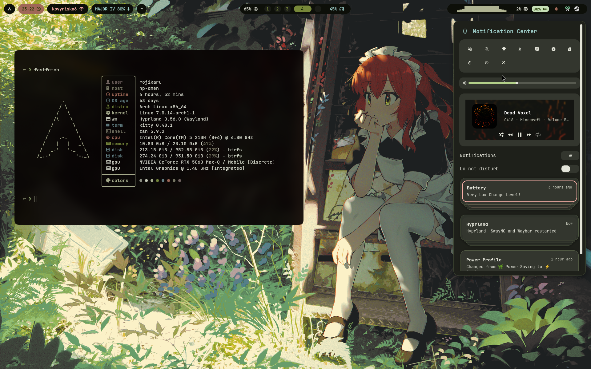
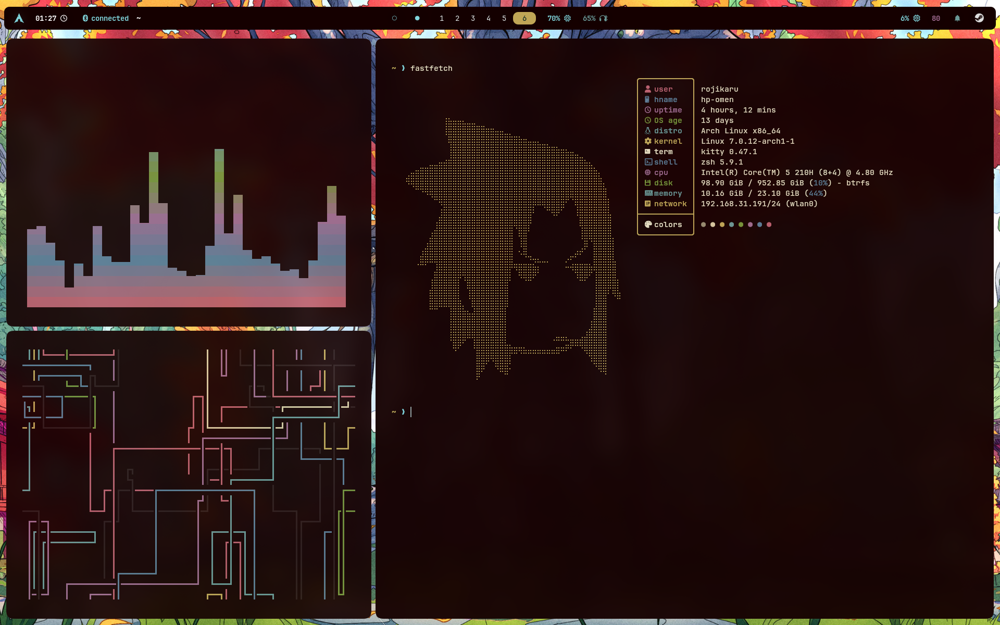

# rojikaru's dots

Arch ([install notes](docs/INSTALLATION.md)) + Hyprland: [ly](https://codeberg.org/fairyglade/ly),
rofi, [skwd-wall](https://github.com/liixini/skwd-wall), wallust + matugen theming,
zsh + starship, LazyVim.

## How it looks





## Installation

Tuned for my HP Omen 16 (Intel) and untested elsewhere. Read the scripts,
`bin`, `config` and package lists before running anything.

The `./install.sh` script is interactive, so have fun!

```bash
git clone https://github.com/rojikaru/dotfiles.git ~/dotfiles
cd ~/dotfiles
./install.sh
```

## Wallpapers

I've stashed some in wallpapers folder and install offers to copy them.

I believe you know the places, but skwd-wall has wallhaven and Steam Workshop
(Wallpaper Engine) integrations, or start here:

- [deeadly137/wallpapers](https://github.com/deeadly137/wallpapers)
- [0xnotkyo/walls](https://github.com/0xnotkyo/walls)

## Other dots worth a shot

- [end4's dots](https://github.com/end-4/dots-hyprland)
- [caelestia dots](https://github.com/caelestia-dots/shell)
- [r/unixporn: browse and pick what you like](https://www.reddit.com/r/unixporn/)
- [Hyprland Hall of Fame](https://hypr.land/hall_of_fame/)

## License

See [LICENSE](LICENSE).

Images in `wallpapers/` and wallpapers seen in `examples/` are not mine,
so [LICENSE](LICENSE) file doesn't cover them. It covers only
configs and scripts really.
